> **Sample with made-up data** (fictional year 2030, generated by `python -m garmin_sync.sample`). Your own dashboard is `reports/dashboard.md`.

# Garmin dashboard

As of 2030-10-24 (today is usually incomplete, hence yesterday). Compared with the median of the 28 days before. Regenerated after every sync.
Clear deviations lasting 2 days: [daily check](daily/). How to read the charts: [chart guide](../charts.md).

| Metric | Yesterday | 28-day median | Difference |
|---|---:|---:|---:|
| Sleep score | 79 | 76 | +3 |
| Sleep duration | 7.4 h | 7.1 | +0.3 |
| HRV (overnight avg) | 36 ms | 47 | -11 |
| Resting heart rate | 52 bpm | 49 | +3 |
| Body Battery max | 84 | 84 | +0 |
| Average stress | 35 | 32 | +3 |
| Steps | 5,631 | 9,988 | -4,358 |

## Last 90 days

Blue: daily value. Grey dashed: median of the previous 28 days. A gap is a day without data, not zero.

### Sleep score

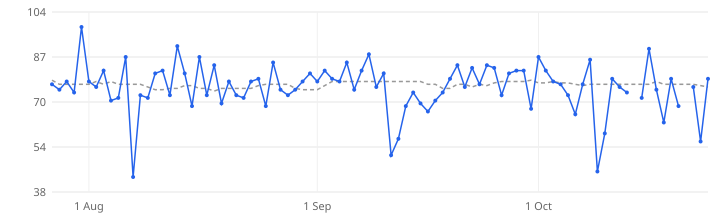

Days with data: 88 of 90. [How to read this chart](../charts.md#sleep_score)

### Sleep duration (h)

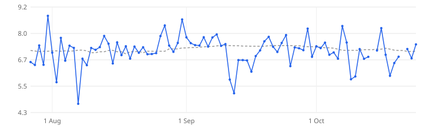

Days with data: 88 of 90. [How to read this chart](../charts.md#sleep_hours)

### HRV (overnight avg) (ms)

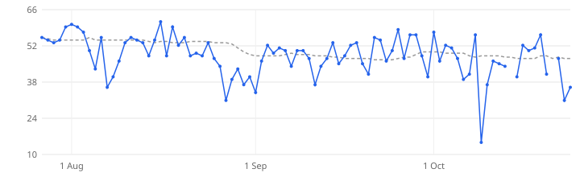

Days with data: 88 of 90. [How to read this chart](../charts.md#hrv)

### Resting heart rate (bpm)

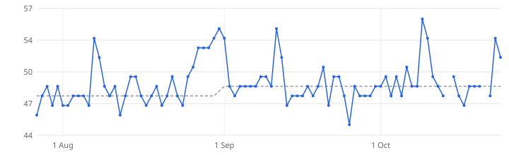

Days with data: 88 of 90. [How to read this chart](../charts.md#resting_hr)

### Body Battery max

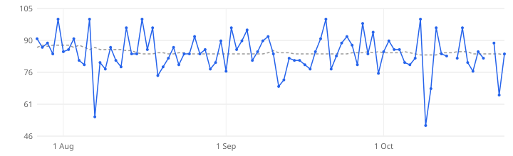

Days with data: 88 of 90. [How to read this chart](../charts.md#body_battery)

### Average stress

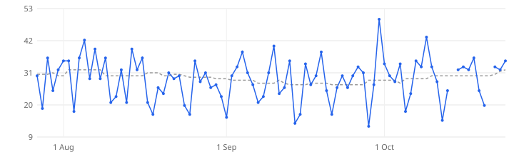

Days with data: 88 of 90. [How to read this chart](../charts.md#stress)

### Steps

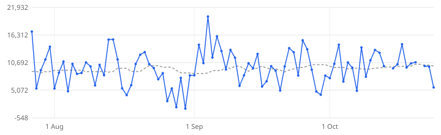

Days with data: 88 of 90. [How to read this chart](../charts.md#steps)

## Year: weekly medians (52 weeks)

One point = median of a week (Monday–Sunday) with at least 4 days of data. Shows the long-term trend that daily values hide.

### Sleep score

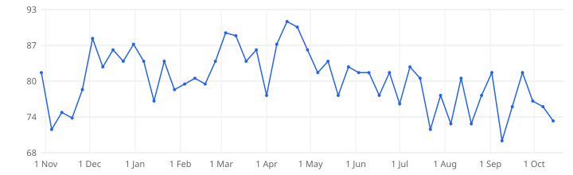

Highest: week of 2030-04-15, 91. Lowest: week of 2030-09-09, 70. Weeks with data: 51 of 52. [How to read the trend](../charts.md#trend)

### Sleep duration (h)

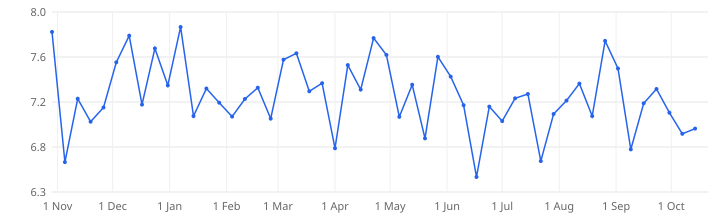

Highest: week of 2030-01-07, 7.9. Lowest: week of 2030-06-17, 6.5. Weeks with data: 51 of 52. [How to read the trend](../charts.md#trend)

### HRV (overnight avg) (ms)

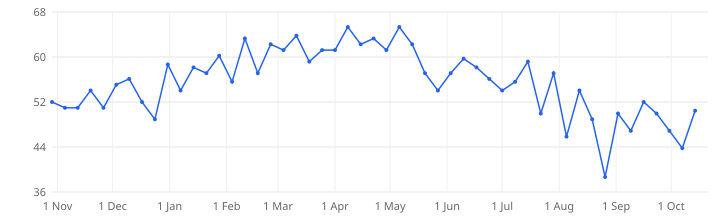

Highest: week of 2030-04-08, 65. Lowest: week of 2030-08-26, 39. Weeks with data: 51 of 52. [How to read the trend](../charts.md#trend)

### Resting heart rate (bpm)

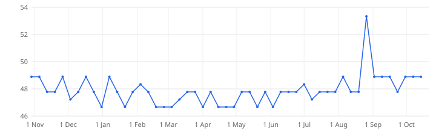

Highest: week of 2030-08-26, 53. Lowest: week of 2029-12-31, 47. Weeks with data: 51 of 52. [How to read the trend](../charts.md#trend)

## Journal, last 30 days

- 2030-10-08 *party, alcohol*: Sample entry.
- 2030-10-22 *party, alcohol*: Sample entry.

## Activities in the last 30 days

| Date | Type | Name | Duration | Distance |
|---|---|---|---:|---:|
| 2030-10-22 | running | — | 34 min | 8.9 km |
| 2030-10-19 | hiking | — | 2 h 06 min | 13.2 km |
| 2030-10-15 | running | — | 45 min | 9.5 km |
| 2030-10-12 | hiking | — | 2 h 56 min | 12.2 km |
| 2030-10-08 | running | — | 45 min | 8.2 km |
| 2030-10-05 | hiking | — | 2 h 12 min | 14.5 km |
| 2030-10-01 | running | — | 53 min | 9.9 km |
| 2030-09-28 | hiking | — | 2 h 47 min | 12.8 km |
